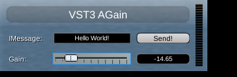
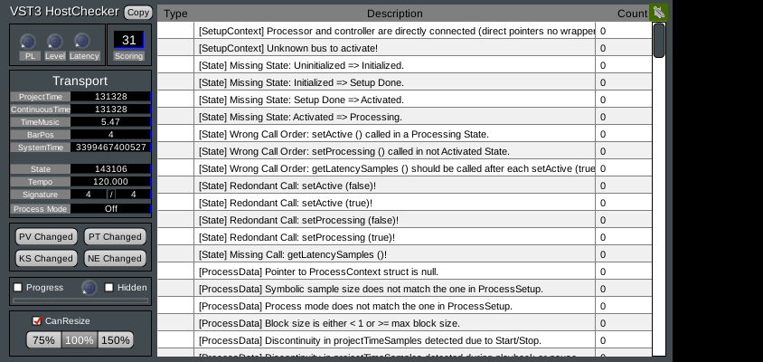

# vst3-to-clap

Turn VST3 plug-ins into CLAP plug-ins.

`vst3-to-clap` is a CLAP plug-in that hosts VST3 plug-ins inside it, plus a small
command-line tool that stamps out a dedicated `.clap` for any `.vst3` you give it. CLAP hosts
(Bitwig, REAPER, MultitrackStudio, …) then see the VST3 as a native CLAP plug-in: audio,
parameters and automation, notes/MIDI, note expressions, state, latency and the plug-in's
own editor.

It is a *wrapper*, not a recompiler: the original `.vst3` is still loaded at runtime, so keep
it installed (or bundle it next to the `.clap` with `--copy-vst3`).

```
vst3-to-clap MySynth.vst3 -o ~/.clap/MySynth.clap
vst3-to-clap MyEffect.vst3 --list
vst3-to-clap mda-vst3.vst3 --class "mda JX10" --copy-vst3 -o ~/.clap/JX10/JX10.clap
```

## Building

Requires CMake ≥ 3.20 and a C++17 compiler. The [VST3 SDK](https://github.com/steinbergmedia/vst3sdk)
and the [CLAP SDK](https://github.com/free-audio/clap) (both MIT licensed) are picked up from
`external/` or fetched automatically.

```sh
git clone --depth 1 https://github.com/free-audio/clap.git external/clap
git clone --depth 1 --recursive --shallow-submodules https://github.com/steinbergmedia/vst3sdk.git external/vst3sdk
cmake -S . -B build -DCMAKE_BUILD_TYPE=Release
cmake --build build --config Release
```

This produces, in `build/`:

| file | what it is |
|---|---|
| `vst3-to-clap-wrapper.clap` | the wrapper (a file on Linux/Windows, a bundle on macOS) |
| `vst3-to-clap` | the command-line converter; it looks for the wrapper next to itself |
| `tools/vst3-to-clap-ui.html` | browser-based converter in the source and release archives |
| `clap-test-host` | headless load/processing test host, optional |

A GitHub Actions workflow (`.github/workflows/build.yml`) builds Linux, macOS (universal) and
Windows binaries.

## Use the graphical converter

The cross-platform, browser-based converter is `tools/vst3-to-clap-ui.html`. Open it in
Chrome, Edge, or Safari (no server or account required), choose the matching wrapper file
(Windows/Linux) or wrapper bundle folder (macOS), plus a `.vst3` bundle folder, then build the
package. Conversion happens entirely on your computer. It downloads a ZIP containing the patched `.clap` and the original `.vst3` beside
it; extract both together into your host's CLAP folder. The wrapper must match the host's OS
and CPU architecture. The UI is included at the root of release archives. macOS bundles need
ad-hoc re-signing after patching; the UI shows the `codesign` command after conversion.

**Troubleshooting a Windows CLAP load:** Windows release archives also include
`clap-test-host.exe`. Run `clap-test-host.exe "C:\path\to\MyPlugin.clap"` to exercise the generated
file outside Bitwig and print Windows loader errors (including missing DLLs and architecture
mismatches). To only check whether the CLAP binary can be loaded, append `--load-only`. A
successful headless load does not replace testing in your DAW, but a failure provides useful
diagnostics.

## Two ways to use it

**1. Command-line converter.** `vst3-to-clap <plugin.vst3>` copies the wrapper and writes
the VST3's location (and optionally one class) into a reserved block inside the copy. The
result is a normal, self-contained `.clap` you drop into your CLAP folder
(`~/.clap`, `~/Library/Audio/Plug-Ins/CLAP`, `%COMMONPROGRAMFILES%\CLAP`).

| option | |
|---|---|
| `-o, --output <path>` | output path (default `./<name>.clap`) |
| `-c, --class <uid\|name>` | wrap only one class of a multi-plug-in module |
| `-l, --list` | list the audio classes in the module |
| `--copy-vst3` | copy the `.vst3` next to the output and reference it relatively, so the pair can be moved together |
| `--relative` | store the path relative to the `.clap` without copying |
| `--template <path>` | use a wrapper binary from somewhere else |

On macOS the converter re-signs the new bundle ad hoc (`codesign -s -`), since patching
invalidates the signature. Sign it properly if you distribute it.

**2. Shell mode.** Install `vst3-to-clap-wrapper.clap` itself and it exposes *every* VST3 it
finds: in the folders listed in `VST3_CLAP_PATH` (`:`-separated, `;` on Windows), or in the
standard VST3 locations. Modules that ship a `moduleinfo.json` are enumerated without being
loaded; others are loaded briefly during the scan.

Each wrapped class gets the CLAP id `vst3.<32-hex class UID>` in both modes, so projects
keep working if you switch between them.

## What gets mapped

| VST3 | CLAP |
|---|---|
| audio buses (main + aux/sidechain) | `audio-ports`, main pair flagged in-place |
| event buses | `note-ports` (CLAP + MIDI dialects) |
| `IEditController` parameters | `params`; VST3 ids are used as CLAP ids. Stepped/list params become integer ranges, others 0…1. Read-only, hidden, bypass, periodic and automatable flags carry over; unit hierarchy becomes the param module path |
| `getParamStringByValue` / `getParamValueByString` | `value_to_text` / `text_to_value` (with a fallback that searches the plug-in's own display strings when it can't parse them) |
| `IComponentHandler` begin/perform/endEdit | `PARAM_GESTURE_BEGIN` / `PARAM_VALUE` / `PARAM_GESTURE_END` (via `request_flush` when not processing) |
| `restartComponent` | `params.rescan`, `latency.changed` (from inside `activate`), `request_restart`, port rescans |
| `IMidiMapping` | incoming MIDI CC, channel pressure and pitch bend drive the mapped parameters; those proxy parameters are hidden from the host. Program change drives the program-change parameter |
| note on/off, poly pressure, note ids | CLAP notes (by note id or key/channel, incl. wildcards) and MIDI 1.0 |
| note expressions | CLAP volume, pan, tuning, vibrato, expression, brightness, pressure |
| `LegacyMIDICCOutEvent`, note output | MIDI / note output events |
| `ProcessContext` | built from the CLAP transport (tempo, time signature, beats/seconds timeline, loop, play/record) |
| component + controller state | `state` (both blobs in one stream) |
| `getLatencySamples`, `getTailSamples` | `latency`, `tail` |
| `kOffline` process mode | `render` (applied on the next activation) |
| `IPlugView` | `gui`: HWND / NSView / X11 (embedded), resizing, content scaling |
| Linux `IRunLoop` | CLAP `timer-support` + `posix-fd-support` |

Other details worth knowing:

- Component and controller are connected through connection proxies; the controller is kept
  in sync with automation and processor output on the main thread.
- `clap_plugin_params::get_value` is answered from a cache updated synchronously by
  `process()`, `flush()` and GUI edits, so hosts see values immediately.
- Values set while deactivated are delivered with the next `process()`. If the host saves
  state before that happens, the wrapper briefly activates the processor and runs one
  sample of silence so the saved state contains them (zero-sample `process()` calls are
  ignored by many plug-ins).
- Output channels a plug-in flags silent are cleared and reported via `constant_mask`;
  output buffers are pre-cleared because some VST3s leave them untouched (e.g. instruments in
  bypass).
- Denormals are flushed to zero during processing.
- Linux run loop registrations are module-wide in VST3 but per-instance in CLAP: a shared
  run loop hosts them on whichever wrapper instance offers the CLAP extensions and migrates
  them when that instance goes away.
- Once a VST3 module is loaded, the wrapper library pins itself in memory: some modules
  (anything linking GTK, for instance) can't be unloaded and keep pointers to the wrapper's
  host objects until process exit.

## Limitations

- 32-bit float processing only (the host converts if it uses 64-bit).
- No CLAP parameter modulation or per-note parameters (VST3 has no equivalent).
- No floating editor windows; editors are always embedded (as in VST3).
- CLAP `audio-ports-config`, `note-name`, `preset-load` and `remote-controls` are not
  implemented. VST3 program lists are exposed only as their program-change parameter.
- Parameter defaults are the VST3 `defaultNormalizedValue`. Some plug-ins (including
  Steinberg's AGain sample) initialise to a different value, which a strict validator
  reports.
- Changing a VST3 "program" parameter overwrites other parameters inside the plug-in; that
  is the plug-in's behaviour, but CLAP tools that randomise every parameter at once will
  notice.
- Linux is the tested platform. The Windows build compiles (cross-built with MinGW) and the
  macOS/Windows code paths are written, but neither has been run in a real host yet. The
  included CI workflow builds with MSVC and Apple Clang.

## Testing

All of this was run on Linux against plug-ins built from the VST3 SDK samples (ADelay,
AGain, AGain Sample Accurate, SyncDelay, Legacy MIDI CC Out, program change samples,
Note Expression Synth, the VST3 Host Checker and the 34 MDA plug-ins):

- `clap-test-host <file.clap> [id]` instantiates every plug-in, lists ports and parameters,
  processes audio with notes, MIDI, note expressions and automation, round-trips the state
  and checks the output. All 34 MDA plug-ins produce sound and pass.
- [clap-validator](https://github.com/free-audio/clap-validator): ADelay passes every
  applicable test (one denormal timing warning). Across the MDA collection 925 tests pass; the remaining failures trace
  back to the plug-ins themselves (declared defaults that differ from the initial value,
  program parameters resetting other parameters, a filter that produces NaN at extreme
  settings, a meter whose read-only parameters change while processing).
- `clap-gui-test` under Xvfb embeds the editors of AGain, Note Expression Synth and the
  Host Checker through CLAP's X11 API (with XEmbed), drives the GUI with synthetic mouse
  input and checks that the host receives gesture and value events. With audio running,
  Steinberg's Host Checker reports no host-behaviour problems.

| AGain's editor, embedded | the VST3 Host Checker |
|---|---|
|  |  |

## Layout

```
src/entry.cpp      clap_entry and plug-in factory
src/registry.*     VST3 discovery, descriptors, module cache, embedded config block
src/plugin.*       one wrapped instance: everything in the table above
src/runloop.*      Linux IRunLoop -> CLAP timer/fd bridge
src/embed.h        layout of the block the converter patches
tools/             the vst3-to-clap converter
tests/             headless and GUI test hosts
```

## Credits

Original creator: therealunclescunter (Discord ID: 1327648622673920073).

## License

MIT. The VST3 SDK and CLAP SDK are MIT licensed by their respective authors.
VST is a registered trademark of Steinberg Media Technologies GmbH.
