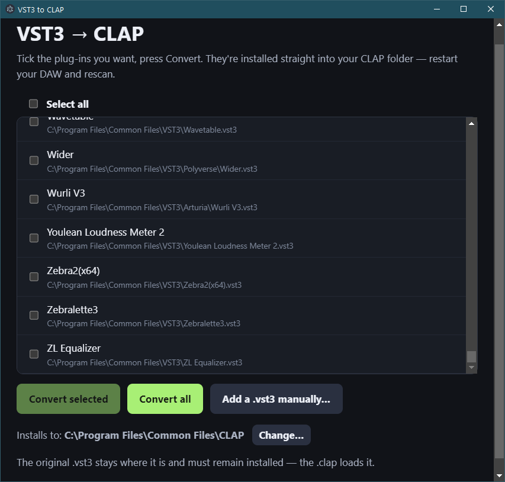

<div align="center">

# 🎛️ VST3 → CLAP

### Use your VST3 plug-ins in any CLAP host.<br>Pick them. Click once. Done.

[](https://github.com/Chimthuwu/vst3-to-clap/releases/latest)
[](https://github.com/Chimthuwu/vst3-to-clap/actions)
[](LICENSE)


<br>



<sub>The desktop app: it finds your plug-ins, you tick the ones you want.</sub>

</div>

<br>

## ✨ How it works

| | |
|:--:|---|
| **1️⃣** | **Open the app.** It lists every VST3 installed on your computer. |
| **2️⃣** | **Tick the plug-ins you want**, or hit **Convert all**. |
| **3️⃣** | **Restart your DAW and rescan.** They show up as CLAP plug-ins. |

That's it. No terminal, no settings, no re-installing anything.

> **Good to know:** the original `.vst3` must stay installed. The new `.clap` is a small wrapper that loads it, so your plug-ins, presets and sounds stay exactly the same.

<br>

## 🚀 Get started

**Run the desktop app**

```sh
cd app
npm install
npm run fetch-wrapper
npm start
```

On Windows, run it **as administrator** so it can write to `C:\Program Files\Common Files\CLAP`
(or press **Change…** to pick any folder you like).

**Prefer a command line?** Grab the zip for your system from the
[**latest release**](https://github.com/Chimthuwu/vst3-to-clap/releases/latest) and run:

```sh
vst3-to-clap "MySynth.vst3"
```

<br>

## 📂 Where do the files go?

| System | CLAP folder |
|---|---|
| 🪟 Windows | `C:\Program Files\Common Files\CLAP` |
| 🍎 macOS | `~/Library/Audio/Plug-Ins/CLAP` |
| 🐧 Linux | `~/.clap` |

The app installs here by default. Bitwig, REAPER and other CLAP hosts look in these folders automatically.

<br>

## ✅ Works with

- 🟢 **Bitwig Studio**: confirmed on Windows with FabFilter Pro-R 2
- 🟢 **Native Instruments Kontakt**: confirmed working on Windows
- 🟢 **Any CLAP host**: audio, parameters, automation, MIDI, presets and the plug-in's own window carry over
- 🟡 **macOS**: builds and converts, not yet tested in a host

<br>

## 📚 The details

<details>
<summary><b>🔧 Command-line options</b></summary>

```
vst3-to-clap MySynth.vst3 -o ~/.clap/MySynth.clap
vst3-to-clap MyEffect.vst3 --list
vst3-to-clap mda-vst3.vst3 --class "mda JX10" --copy-vst3 -o ~/.clap/JX10/JX10.clap
```

| option | |
|---|---|
| `-o, --output <path>` | output path (default `./<name>.clap`) |
| `-c, --class <uid or name>` | wrap only one class of a multi-plug-in module |
| `-l, --list` | list the audio classes in the module |
| `--copy-vst3` | copy the `.vst3` next to the output and reference it relatively |
| `--relative` | store the path relative to the `.clap` without copying |
| `--template <path>` | use a wrapper binary from somewhere else |

On macOS the converter re-signs the new bundle ad hoc (`codesign -s -`). Sign it properly if you distribute it.

**Shell mode:** install `vst3-to-clap-wrapper.clap` itself and it exposes *every* VST3 it finds, in `VST3_CLAP_PATH` or the standard VST3 folders.

</details>

<details>
<summary><b>🌐 Browser converter</b></summary>

`tools/vst3-to-clap-ui.html` does the same job in a web page (Chrome, Edge, Safari). Choose the matching wrapper and a `.vst3` folder, then download a ZIP and extract it into your CLAP folder. Nothing is uploaded; it all runs locally. The desktop app is easier.

</details>

<details>
<summary><b>🩺 Troubleshooting (Windows)</b></summary>

Windows release zips include `clap-test-host.exe`:

```
clap-test-host.exe "C:\path\to\MyPlugin.clap"
```

It loads the file outside your DAW and prints Windows loader errors (missing DLLs, wrong architecture). Add `--load-only` to only check that it loads. Remember: re-convert any `.clap` made before v1.0.2.

</details>

<details>
<summary><b>🔁 What gets mapped</b></summary>

| VST3 | CLAP |
|---|---|
| audio buses (main + aux/sidechain) | `audio-ports`, main pair flagged in-place |
| event buses | `note-ports` (CLAP + MIDI dialects) |
| `IEditController` parameters | `params`; VST3 ids are used as CLAP ids. Stepped/list params become integer ranges, others 0…1. Read-only, hidden, bypass, periodic and automatable flags carry over; unit hierarchy becomes the param module path |
| `getParamStringByValue` / `getParamValueByString` | `value_to_text` / `text_to_value` (with a fallback that searches the plug-in's own display strings when it can't parse them) |
| `IComponentHandler` begin/perform/endEdit | `PARAM_GESTURE_BEGIN` / `PARAM_VALUE` / `PARAM_GESTURE_END` (via `request_flush` when not processing) |
| `restartComponent` | `params.rescan`, `latency.changed` (from inside `activate`), `request_restart`, port rescans |
| `IMidiMapping` | incoming MIDI CC, channel pressure and pitch bend drive the mapped parameters; those proxy parameters are hidden from the host. Program change drives the program-change parameter |
| note on/off, poly pressure, note ids | CLAP notes (by note id or key/channel, incl. wildcards) and MIDI 1.0 |
| note expressions | CLAP volume, pan, tuning, vibrato, expression, brightness, pressure |
| `LegacyMIDICCOutEvent`, note output | MIDI / note output events |
| `ProcessContext` | built from the CLAP transport (tempo, time signature, beats/seconds timeline, loop, play/record) |
| component + controller state | `state` (both blobs in one stream) |
| `getLatencySamples`, `getTailSamples` | `latency`, `tail` |
| `kOffline` process mode | `render` (applied on the next activation) |
| `IPlugView` | `gui`: HWND / NSView / X11 (embedded), resizing, content scaling |
| Linux `IRunLoop` | CLAP `timer-support` + `posix-fd-support` |

Other details worth knowing:

- Component and controller are connected through connection proxies; the controller is kept
  in sync with automation and processor output on the main thread.
- `clap_plugin_params::get_value` is answered from a cache updated synchronously by
  `process()`, `flush()` and GUI edits, so hosts see values immediately.
- Values set while deactivated are delivered with the next `process()`. If the host saves
  state before that happens, the wrapper briefly activates the processor and runs one
  sample of silence so the saved state contains them (zero-sample `process()` calls are
  ignored by many plug-ins).
- Output channels a plug-in flags silent are cleared and reported via `constant_mask`;
  output buffers are pre-cleared because some VST3s leave them untouched (e.g. instruments in
  bypass).
- Denormals are flushed to zero during processing.
- Linux run loop registrations are module-wide in VST3 but per-instance in CLAP: a shared
  run loop hosts them on whichever wrapper instance offers the CLAP extensions and migrates
  them when that instance goes away.
- Once a VST3 module is loaded, the wrapper library pins itself in memory: some modules
  (anything linking GTK, for instance) can't be unloaded and keep pointers to the wrapper's
  host objects until process exit.

</details>

<details>
<summary><b>⚠️ Limitations</b></summary>

- 32-bit float processing only (the host converts if it uses 64-bit).
- No CLAP parameter modulation or per-note parameters (VST3 has no equivalent).
- No floating editor windows; editors are always embedded (as in VST3).
- CLAP `audio-ports-config`, `note-name`, `preset-load` and `remote-controls` are not
  implemented. VST3 program lists are exposed only as their program-change parameter.
- Parameter defaults are the VST3 `defaultNormalizedValue`. Some plug-ins (including
  Steinberg's AGain sample) initialise to a different value, which a strict validator
  reports.
- Changing a VST3 "program" parameter overwrites other parameters inside the plug-in; that
  is the plug-in's behaviour, but CLAP tools that randomise every parameter at once will
  notice.
- Windows is verified in Bitwig (FabFilter Pro-R 2) and with the headless test host; Linux was
  tested the most. macOS builds in CI but has not been run in a real host yet.

</details>

<details>
<summary><b>🧪 How it was tested</b></summary>

All of this was run on Linux against plug-ins built from the VST3 SDK samples (ADelay,
AGain, AGain Sample Accurate, SyncDelay, Legacy MIDI CC Out, program change samples,
Note Expression Synth, the VST3 Host Checker and the 34 MDA plug-ins):

- `clap-test-host <file.clap> [id]` instantiates every plug-in, lists ports and parameters,
  processes audio with notes, MIDI, note expressions and automation, round-trips the state
  and checks the output. All 34 MDA plug-ins produce sound and pass.
- [clap-validator](https://github.com/free-audio/clap-validator): ADelay passes every
  applicable test (one denormal timing warning). Across the MDA collection 925 tests pass; the remaining failures trace
  back to the plug-ins themselves (declared defaults that differ from the initial value,
  program parameters resetting other parameters, a filter that produces NaN at extreme
  settings, a meter whose read-only parameters change while processing).
- `clap-gui-test` under Xvfb embeds the editors of AGain, Note Expression Synth and the
  Host Checker through CLAP's X11 API (with XEmbed), drives the GUI with synthetic mouse
  input and checks that the host receives gesture and value events. With audio running,
  Steinberg's Host Checker reports no host-behaviour problems.

| AGain's editor, embedded | the VST3 Host Checker |
|---|---|
|  |  |

</details>

<details>
<summary><b>🗂️ Source layout</b></summary>

```
src/entry.cpp      clap_entry and plug-in factory
src/registry.*     VST3 discovery, descriptors, module cache, embedded config block
src/plugin.*       one wrapped instance: everything in the table above
src/runloop.*      Linux IRunLoop -> CLAP timer/fd bridge
src/embed.h        layout of the block the converter patches
tools/             the vst3-to-clap converter + browser UI
app/               Electron desktop app
tests/             headless and GUI test hosts
```

</details>

<details>
<summary><b>🏗️ Building from source</b></summary>

```sh
git clone --depth 1 https://github.com/free-audio/clap.git external/clap
git clone --depth 1 --recursive --shallow-submodules https://github.com/steinbergmedia/vst3sdk.git external/vst3sdk
cmake -S . -B build -DCMAKE_BUILD_TYPE=Release
cmake --build build --config Release
```

Requires CMake ≥ 3.20 and a C++17 compiler.

</details>


<br>

---

<div align="center">

## 💚 Credits

**Original creator: [therealunclescunter](https://github.com/unclescunter)**

MIT licensed. The VST3 SDK and CLAP SDK are MIT licensed by their respective authors.<br>
<sub>VST is a registered trademark of Steinberg Media Technologies GmbH.</sub>

</div>
